## Skill radar

<table>
<tr>
<td width="55%" valign="top">
  
</td>
<td valign="top">

<!-- SKILLS:START -->
**UI Automation** · 87%  
Playwright · Appium · WinAppDriver · PyWinAuto · Selenium · Squish

**API Testing** · 93%  
REST · Postman · RestAssured · RestSharp · GraphQL · Swagger

**LLM Evals** · 80%  
RAGAS · DeepEval · PromptFoo

**Security** · 67%  
JMeter · Burp Suite · OWASP ZAP · Nmap · Wireshark · FFUF

**DevOps** · 80%  
GitHub Actions · Azure DevOps · Jenkins · Docker · Vercel · Kubernetes

**Frontend** · 80%  
Next.js · React · Tailwind · FastAPI · TypeScript · Vue 3

**Backend** · 80%  
Next.js · React · Tailwind · FastAPI · TypeScript · Vue 3
<!-- SKILLS:END -->

</td>
</tr>
</table>

## 🛍️ Product shelf

<!-- SHELF:START -->
<table>
<tr>
  <td align="center" valign="top"></td>
  <td align="center" valign="top"></td>
  <td align="center" valign="top"></td>
</tr>
</table>
<!-- SHELF:END -->

More at <a href="https://codebygk.com/products">codebygk.com/products</a>.

## 🌌 Repo constellation

<!-- CONSTELLATION:START -->

  

| Repo | Cluster | Language | ★ | Last push |
|:--|:--|:--|--:|:--|
| **[test-automation-handbook](https://github.com/codebygk/test-automation-handbook)** Test Automation Handbook For SDETs and QA Automation Engine… | Handbooks | Python | 1 | 2026-10-09 |
| **[dsa-handbook](https://github.com/codebygk/dsa-handbook)** A practical handbook of Data Structures and Algorithms prob… | Handbooks | Python | 0 | 2026-10-16 |
| **[ai-handbook](https://github.com/codebygk/ai-handbook)** AI handbook: practical notes on machine learning, LLMs, pro… | Handbooks | Other | 2 | 2026-09-24 |
| **[playwright-handbook](https://github.com/codebygk/playwright-handbook)** Playwright handbook: practical notes and examples on setup,… | Handbooks | TypeScript | 0 | 2026-08-24 |
| **[opensource-apps](https://github.com/codebygk/opensource-apps)** Curated free and open-source software (FOSS) alternatives t… | Tools & Apps | Other | 0 | 2026-08-22 |
| **[crawlens](https://github.com/codebygk/crawlens)** A Go-based web crawler that audits websites for SEO and acc… | Tools & Apps | Go | 0 | 2026-01-19 |
| **[cybersecurity-handbook](https://github.com/codebygk/cybersecurity-handbook)** Cybersecurity handbook for beginners: notes on Linux, Windo… | Security | Other | 0 | 2026-10-06 |
| **[hackerone-bug-bounty-reports](https://github.com/codebygk/hackerone-bug-bounty-reports)** Complete collection of bug bounty reports from Hackerone. | Security | Python | 97 | 2024-10-13 |
| **[playwright-ts-framework](https://github.com/codebygk/playwright-ts-framework)** Playwright test automation framework in typescript. | Experiments | TypeScript | 0 | 2026-09-10 |
<!-- CONSTELLATION:END -->