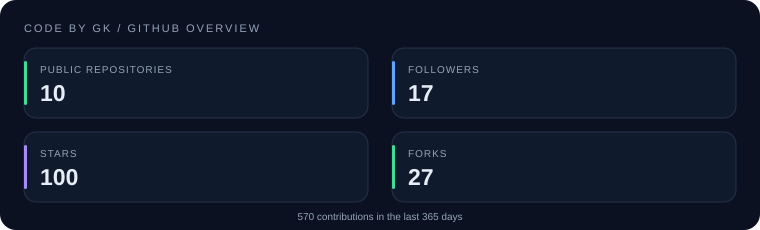
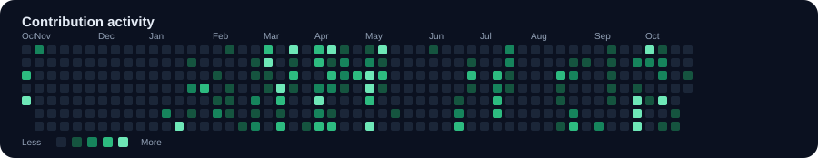
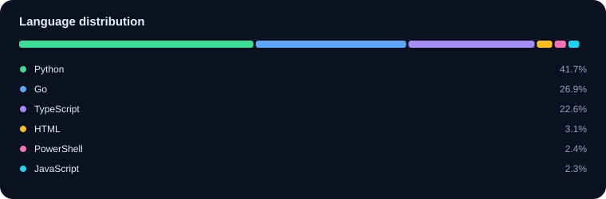

# Code By GK

### Building Practical Tools, Products & Resources

Developer tools · Automation · AI · Learning in public

[Website](https://codebygk.com) · [GitHub](https://github.com/codebygk)

---

## GitHub at a glance

| Metric | Value |
|:--|--:|
| Contributions in the last 365 days | 570 |
| Public repositories | 10 |
| Stars across public repositories | 100 |
| Forks across public repositories | 27 |
| Followers | 17 |
| Following | 1 |

## Contribution activity

## Language distribution

_Language percentages are based on GitHub's reported language byte counts for public, non-fork repositories._

## Featured repositories

| Repository | Description | Stars | Forks |
|:--|:--|--:|--:|
| [hackerone-bug-bounty-reports](https://github.com/codebygk/hackerone-bug-bounty-reports) | Complete collection of bug bounty reports from Hackerone. | 97 | 27 |
| [ai-handbook](https://github.com/codebygk/ai-handbook) | AI handbook: practical notes on machine learning, LLMs, prompt engineering, RAG, AI age... | 2 | 0 |
| [test-automation-handbook](https://github.com/codebygk/test-automation-handbook) | Test Automation Handbook For SDETs and QA Automation Engineers: Notes, Tips, and Interv... | 1 | 0 |
| [dsa-handbook](https://github.com/codebygk/dsa-handbook) | A practical handbook of Data Structures and Algorithms problems solved primarily using ... | 0 | 0 |
| [cybersecurity-handbook](https://github.com/codebygk/cybersecurity-handbook) | Cybersecurity handbook for beginners: notes on Linux, Windows, networking, cryptography... | 0 | 0 |
| [playwright-ts-framework](https://github.com/codebygk/playwright-ts-framework) | Playwright test automation framework in typescript. | 0 | 0 |

## Technology stack

**Languages**

`Python` `TypeScript` `JavaScript` `C#` `Java` `SQL`

**Automation**

`Selenium` `Playwright` `Squish` `Appium` `WinAppDriver` `PyWinAuto` `pytest` `TestNG` `NUnit`

**API & Performance**

`REST APIs` `GraphQL` `Postman` `Swagger` `RestAssured` `RestSharp` `JMeter`

**Frontend**

`React` `Next.js` `Vue` `Angular` `Tailwind CSS`

**Backend & Databases**

`FastAPI` `Express.js` `PostgreSQL` `SQL Server`

**DevOps & Tools**

`Git` `Azure DevOps` `Jenkins` `GitHub Actions` `Docker` `Kubernetes`

**AI & GenAI**

`LLMs` `Generative AI` `LLM Evaluation`

## About

Code By GK | Senior SDET | QA Automation Expert | AI Testing & LLM Evaluation | Python, Playwright, Selenium | Shipping Software Products & Resources

- Website: https://codebygk.com
- GitHub: https://github.com/codebygk

---

Automatically updated from GitHub API · Last generated 2026-10-19 20:34 UTC

